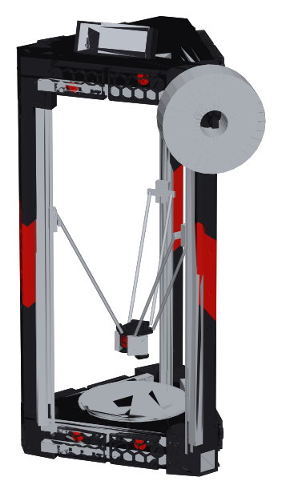
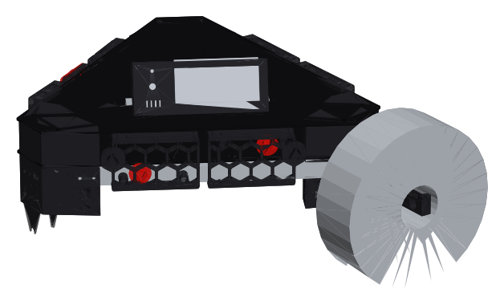
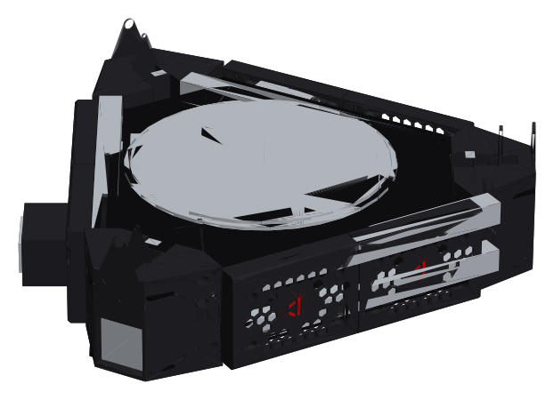
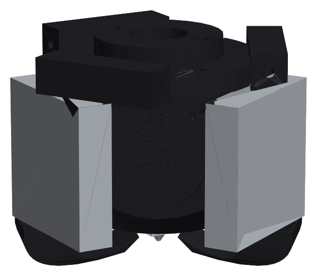

<h1 align="center">DVF-ACLP</h1>
<p align="center"><b>Doron Velta styling for the Anycubic Kossel Linear Plus</b></p>

<p align="center">
  
</p>

<p align="center">
  
  
  
  
</p>

---

## Overview

**DVF-ACLP** brings the look of **[Doron Velta](https://github.com/rogerlz/Doron-Velta)** by rogerlz to the Anycubic Kossel Linear Plus.

* The **original Doron Velta skirts, logo, fan grill, fan mount and spool holder** are used as designed. They have only been given hidden mounting points for the Kossel's 2020 rails.
* New DV-style **corners, tower pillars, top and bottom sections and toolhead** fit the stock Kossel frame, rails, arms, motors and bed.
* The controller changes to a **BTT SKR Pico + Raspberry Pi 3B** running Klipper.
* The sides stay open, with no doors or side panels.

| Colour | Used for |
|---|---|
| ⬛ **Black** | Main printed parts |
| 🟥 **Red** | Accent parts. Their files start with **`[a]`**, as in Doron Velta. |
| ⬜ **Silver** | Stock Kossel aluminium, bought parts |

> ⚠️ **Prototype.** The parts are modelled from published dimensions and the original DV files. They have not been built or fit-tested yet. Print the fit-test piece and one corner first.

## Renders

| Top section | Bottom section | Toolhead |
|:---:|:---:|:---:|
|  |  |  |

## Features

* **Original DV skirts** with the honeycomb grill and the DV logo insert. They mount on the Kossel rails with hidden M4 bosses.
* **Top section**
  * The original DV fan mount and red fan grill hold a 60 mm intake fan.
  * The SKR Pico and Pi 3B sit on a tray under a plain DV-style lid.
  * The stock Kossel 2004 LCD sits in a tilted case on the front of the lid.
* **Bottom section**
  * Holds a 12 V box PSU with a mains terminal cover.
  * The bed deck under the bed separates it from the print area.
* **Power inlet** on the right side holds an IEC C14 socket with fuse and red rocker switch (screw flange).
* **DV-style corners** replace the stock Anycubic corners. They fit the stock 2020 extrusions and hold the NEMA17 motors, idlers and endstops.
* **Tower pillars**
  * Black covers with the slanted red DV band.
  * Hollow, so the cables run inside.
* **DV-style toolhead** for the stock 269 mm arms
  * Hex shroud with the DV logo.
  * 3010 hotend fan and twin 4010 part-cooling ducts.
* **Side extruder bracket** carries the stock Bowden extruder and the original DV spool holder.

## Repository

```
STLs/                                print files (_xN = quantity, [a] = accent colour)
STEP/DVF_ACLP_FULL_ASSEMBLY_step.zip complete printer (115 MB STEP, zipped for GitHub): unzip, open in SolidCraft / SolidWorks / Fusion
STEP/parts/                          every printed part as an editable solid
STEP/panels_cut_3mm/                 bottom panel, bed deck, top deck, lid: cut from 3 mm black ACM
images/                              renders
```

## Print list

| Group | Part | Qty |
|---|---|---:|
| Fit test | `dv_skirt_fit_test`: print first and check it on the lower rails | 1 |
| Corners | `corner_bottom_motor`, `corner_top_idler`, `corner_top_cap` | 3 each |
| Pillars | `pillar_lower`, `pillar_upper` | 3 each |
| Pillars | `[a]pillar_band_lower`, `[a]pillar_band_upper` | 3 each |
| Bottom skirts (DV) | `dv_bottom_skirt_left`, `dv_bottom_skirt_right`, `dv_bottom_skirt_power_RIGHT` | 2 / 3 / 1 |
| Top skirts (DV) | `dv_top_skirt_left`, `dv_top_skirt_right` | 2 / 2 |
| Top skirts (DV) | `dv_top_skirt_fan_left`, `dv_top_skirt_fan_right`, `dv_fan_mount` | 1 each |
| Accents (DV) | `[a]dv_fan_grill_ORIGINAL` | 1 |
| Accents (DV) | `[a]dv_logo_insert` | 12 |
| Accents (DV) | `[a]dv_logo_badge_toolhead` | 1 |
| Power | `power_inlet_box`, `psu_bracket`, `psu_terminal_cover` | 1 each |
| Power | `bed_standoff` | 3 |
| Electronics | `skr_pico_pi3b_tray`, `top_channel`, `top_channel_lid` | 1 each |
| Electronics | `lcd_case_front`, `lcd_case_back` (stock Kossel LCD, front of the lid) | 1 each |
| Toolhead | `effector_v6`, `groove_clamp`, `dv_shroud` | 1 each |
| Toolhead | `dv_duct_4010` | 2 |
| Extruder | `side_extruder_spool_mount`, `dv_spool_holder_ORIGINAL` | 1 each |
| Misc | `cable_clip_2020` | 8 |

**Materials:** PETG or better for the frame parts and skirts. ABS/ASA for the toolhead and the power inlet box. Every part fits the Kossel's Ø230 mm bed. The pillar pieces come already turned so their flat end is on the bed.

## Hardware

| Item | Qty |
|---|---:|
| BTT SKR Pico v1.0 (4× TMC2209) + Raspberry Pi 3B | 1 + 1 |
| 12 V box PSU, 215 × 115 × 50 mm | 1 |
| IEC C14 inlet with fuse and rocker switch, screw flange (48 × 28 mm cut-out, M3 holes 40 mm apart) | 1 |
| 60 mm 12 V fan (top intake) / 3010 fan (hotend) / 4010 blower (part cooling) | 1 / 1 / 2 |
| 3 mm black ACM sheet, about 430 × 370 mm (4 panels) | 4 |
| M4 × 10 + 2020 T-nuts | ~70 |
| M4 × 50 (corners → towers) | 12 |
| M3 screws + M2.5 / M3 / M4 / M5 heat-set inserts | set |

> ⚡ **Mains safety:** wire the inlet (fuse and switch) to the PSU only with the printer unplugged. Connect earth to both the PSU and the frame. Fit the terminal cover before switching on.

## Stock LCD (RepRapDiscount 2004 Smart Controller)

The LCD that came with the Kossel sits in a printed case on the front of the lid, tilted back 20°. The case bolts to the lid with 2× M3, and the ribbon cables drop through a slot in the lid.

* **Case:** 4× M3 into the PCB standoffs and 4× M3 for the back cover.
* **Measure first:** the case is built for a 150 × 55 mm board with mounting holes 144 × 49 mm apart. Check your board.

The **SKR Pico has no EXP1/EXP2 LCD connectors**, so the LCD wires to the **Raspberry Pi GPIO**. Klipper runs the Pi as a second MCU for it (Klipper's "RPi microcontroller" guide). Use the **EXP1** connector:

| LCD (EXP1) | Pi GPIO (BCM) | Pi pin |
|---|---|---:|
| 5V / GND | 5V / GND | 2 / 6 |
| LCD RS | GPIO5 | 29 |
| LCD E | GPIO6 | 31 |
| D4 / D5 / D6 / D7 | GPIO13 / GPIO19 / GPIO26 / GPIO21 | 33 / 35 / 37 / 40 |
| Encoder click | GPIO12 | 32 |
| Beeper | GPIO25 | 22 |

**EXP2** has the encoder A/B pins. Wire them to **GPIO20 / GPIO16** (pins 38 / 36).

```ini
[mcu rpi]
serial: /tmp/klipper_host_mcu

[display]
lcd_type: hd44780
rs_pin: rpi:gpio5
e_pin: rpi:gpio6
d4_pin: rpi:gpio13
d5_pin: rpi:gpio19
d6_pin: rpi:gpio26
d7_pin: rpi:gpio21
encoder_pins: ^rpi:gpio20, ^rpi:gpio16
click_pin: ^!rpi:gpio12

[output_pin beeper]
pin: rpi:gpio25
```

The Pi's GPIO pins are 3.3 V. The 2004 LCD only reads these signals and works at 3.3 V logic. Never connect any LCD 5 V line to a Pi GPIO pin.

## Before you print

Measure your printer and compare it with these defaults. The design was built from them:

| What | Default |
|---|---|
| Horizontal 2020 length | 300 mm |
| Vertical 2020 length | 720 mm |
| Spacing between the two lower rails (centre to centre) | 45 mm |
| Stock arm ball-joint spacing | 46 mm |

## Credits

* **Doron Velta** by [rogerlz](https://github.com/rogerlz/Doron-Velta) (GPL-3.0). The skirts, logo, fan grill, fan mount and spool holder are the original DV files. The DV logo is by @matrixray.
* Fork: [Xanjip32/Doron-Velta](https://github.com/Xanjip32/Doron-Velta).
* This project is released under **GPL-3.0**. It is not an official Voron, Doron Velta or Anycubic project.
