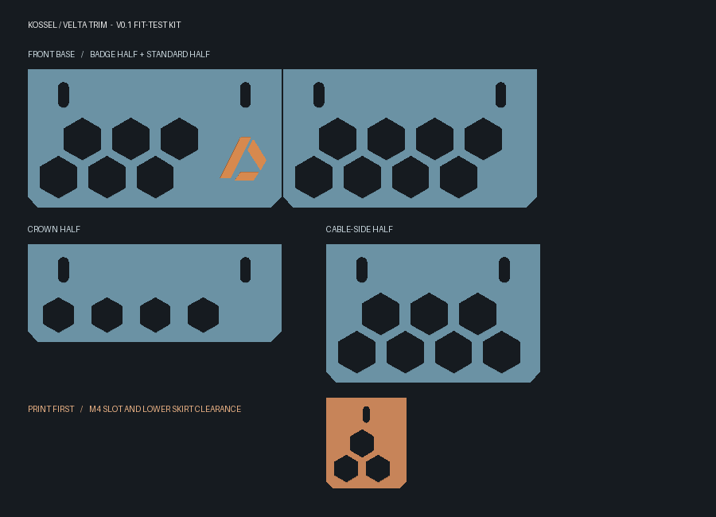

# Doron Velta trim for the Anycubic Kossel Linear Plus

[Download the v0.1 kit](Kossel-Velta-Trim-v0.1.zip) · [Download the M4 fit test](models/00_M4_Fit_Test.stl)

**v0.1 fit-test kit.** A removable honeycomb base and crown for the open-frame Linear Plus. The skirt uses the stock extrusion slots. The stock bed, rails, arms, belts, endstops, Bowden extruder, and toolhead stay in place. The exterior uses the same parts with either controller.

## Print list

| File | Qty | Fit and placement |
|---|---:|---|
| 00_M4_Fit_Test.stl | 1 | Print first. Check the M4 slot, rail face, and full 44 mm skirt drop. |
| 01_Base_Half.stl | 3 | One half beside the badge at the front and two halves on the second face. |
| 02_Base_Badge_Half.stl | 1 | Left half of the front face, with the raised emblem near the middle. |
| 03_Rear_Cable_Half.stl | 2 | Leave a 32 mm opening between the halves on the cable side. |
| 04_Top_Half.stl | 6 | Two per top rail. Turn the panels so their vented area rises above the rail. |
| 05_Upper_Corner_Accent.stl | Up to 6 | Optional short accent on either side of an upper corner, wherever there is free outer rail. |
| 06_Optional_SKR_Pico_Plate.stl | 0 or 1 | Optional internal rail adapter for the SKR Pico v1.0. Keep the existing bracket if using the stock TriGorilla. |

The assembly uses 24 sets of M4 screws, washers, and slot nuts for the six base and six crown halves. Add one set per corner accent and two for the Pico plate if used. The factory manual lists M4 screws and M4 square nuts. Match the nut to the actual slot profile. Use roll-in nuts if they seat correctly in your profile. Fit the screw length to the nut and slot depth with the 3.2 mm panel and washer installed. For the Pico, use four M2.5 standoffs with matching fasteners, board clearance below, and room to plug in the wiring and USB cable. The hole centers follow the 58 × 49 mm drawing for SKR Pico v1.0. Generic hardware search terms are “M4 2020 T-slot nut,” “M4 button-head screw and washer,” and “M2.5 PCB standoff.”

## Install

1. Slice the fit test with its flat back on the bed. Use a 0.2 mm layer height and three perimeters as a starting point. PETG is suitable for the first exterior fit test. Use a material appropriate to the temperatures at the final mounting position.
2. With power off, test the coupon on the outward-facing slot of the upper rail in the lower triangle. Confirm that the back sits flat, the nut is captive, the skirt clears the table and corner, and the LCD, power connection, and wiring remain accessible. Position the parts on the sides that leave those ports free. If the stock LCD overlaps the trim, leave that segment off or shift it before printing the full set.
3. Center the split panels on each face. The standard pairs are 200 mm across with a 1 mm joint. The cable-side pair is 200 mm across with a 32 mm opening. Keep the lower vents clear. Mount crown panels on the outer faces and check access to the idlers and endstops.
4. Test one crown half before printing the full crown. After assembly, confirm that the head, rods, carriages, and Bowden tube clear the trim over their travel. Keep cables clear of moving parts. Use the existing cable restraint for strain relief.

## Stock geometry and fit status

The Anycubic manual specifies 300 mm crossmembers for Linear Plus and M4 slot hardware. The 200 mm covered width leaves room at the ends of the nominal crossmember. The 44 mm lower drop, 28 mm crown rise, and 10 mm mounting lip are prototype dimensions. The manual does not dimension the molded corner housings or show a tolerance drawing for the assembled clear spans. The short accents mount beside the housings instead of wrapping them. The draft uses independent panels to accommodate variations across faces.

All seven CAD solids were checked and exported as closed STL meshes. Physical fit has not been tested. The STLs are print geometry. The matching STEP files are editable solid geometry. Build new sizes with FreeCAD 1.1's bundled Python, for example:

    "<FreeCAD>/bin/python.exe" build_trim.py --span 200 --base-reach 44 --top-reach 28 --rear-gap 32

## Design references

- [Roger Luz's Doron Velta R2 v20 CAD](https://github.com/rogerlz/Doron-Velta/tree/main/CAD) and [DV skirt files](https://github.com/rogerlz/Doron-Velta/tree/main/STLs/Skirts/DV_Logo) informed the honeycomb layout and raised accent. The Kossel panels and mounting geometry were modeled separately.
- [Anycubic's Kossel assembly manual](https://www.treatstock.com/static/uploads/printers/Kossel-manual-English-20160822.pdf), parts list and assembly steps 1–6.
- [BIGTREETECH SKR Pico v1.0 manual](https://github.com/bigtreetech/SKR-Pico/blob/master/BTT%20SKR%20Pico%20V1.0%20Instruction%20Manual.pdf), motherboard size diagram.

