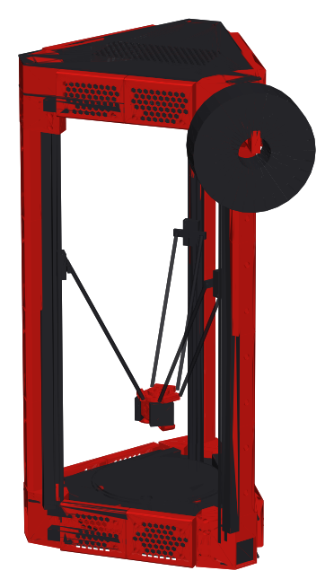
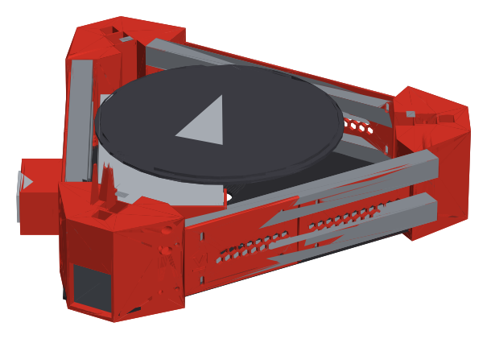
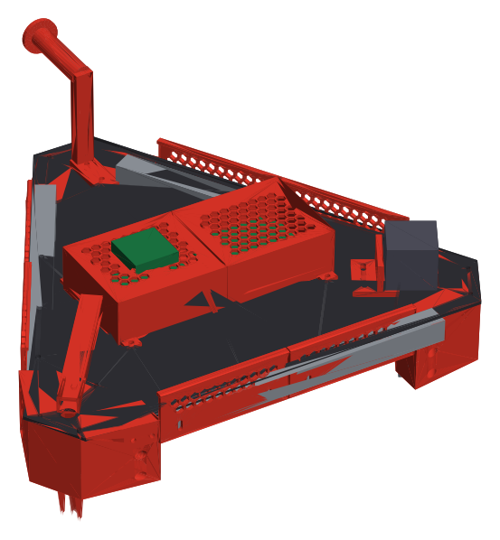
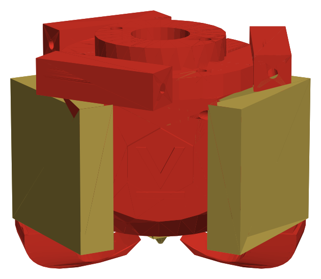
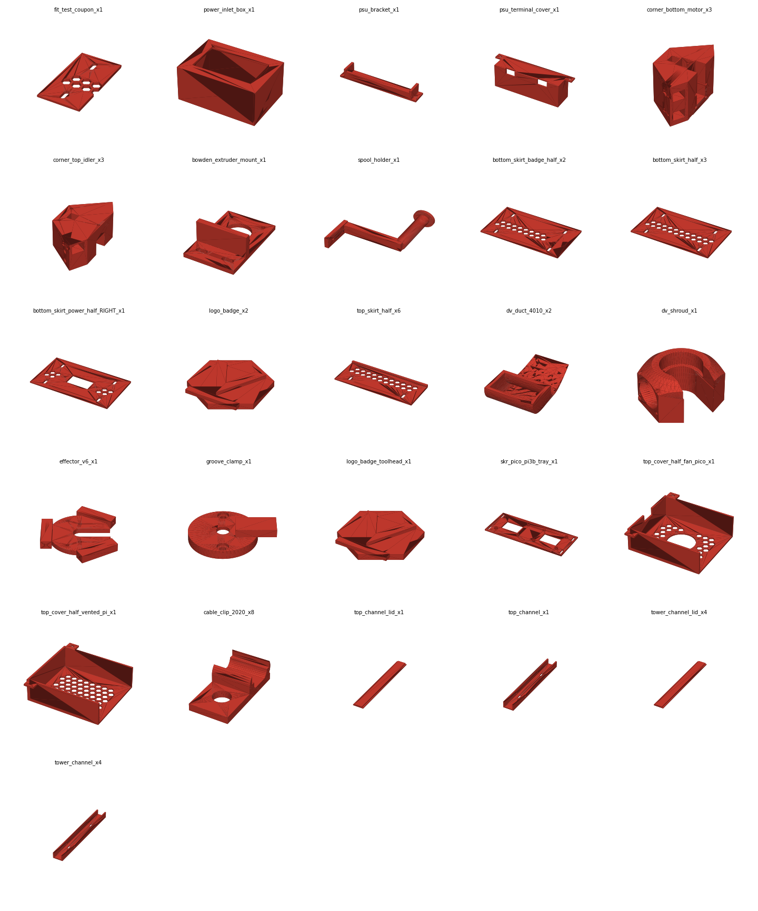

# DVF-ACLP: Doron Velta Fork for the Anycubic Kossel Linear Plus

A Doron Velta style rebuild of the **Anycubic Kossel Linear Plus**. It uses new printed corners, a closed power base, a top electronics bay and skirts. It keeps the stock **2020 aluminium extrusions, MGN12 rails, motors, belts, arms, bed and hotend**. The controller changes to **BTT SKR Pico v1.0 + Raspberry Pi 3B (Klipper)**. The sides stay open, with no doors or side panels.



| Power base | Top electronics bay | Toolhead |
|---|---|---|
|  |  |  |

> ⚠️ **v0.2, not yet built or fit-tested.** All parts are generated from [`CAD/params.json`](CAD/params.json), and several values are estimates (see below). Print `00_Fit_Test` and **one bottom corner** first.

## What's new in v0.2

* **New corners (replace the stock Anycubic corners).**
  * **Bottom motor corner:** pockets for the two lower 2020 rails and the tower. It has a NEMA17 bay with the shaft pointing to the centre, a belt and pulley opening, a cable duct behind the tower, and rubber-foot recesses.
  * **Top idler corner:** top rail and tower pockets, an M3 idler axle slot with an adjuster screw, holes for the stock endstop board, M3 inserts for the top panel, and a cable duct.
  * Each pocket is held with M4 screws into the extrusion slots.
* **Bottom power base.**
  * A cut floor panel (`DXFs/bottom_panel_x1.dxf`) holds a standard **12 V 215 × 115 × 50 mm box PSU** with a printed bracket and a **mains terminal cover**.
  * On the **right half of one side**, a printed **power inlet box** holds an **IEC C14 inlet with fuse and rocker switch**. You plug in and switch on directly there.
* **Top electronics bay.**
  * A cut top panel (`DXFs/top_panel_x1.dxf`) carries the **SKR Pico + Pi 3B tray**.
  * Two printed covers go over it: one with a 40 mm fan over the Pico, one vented over the Pi.
* **Wiring channels.**
  * Printed U-channels with press-fit lids run up the outside of tower A.
  * The cables then go through the duct in the top corner and along a top channel into the cover's cable notch.
  * The 12 V cable from the PSU goes up this path. Mains stays in the base.

## Measure these before printing

| Parameter | Default | What it is |
|---|---|---|
| `frame.rail_len` | 300 | Length of the horizontal 2020s (Anycubic manual) |
| `frame.tower_len` | 720 | Length of the vertical 2020s. **Measure.** |
| `frame.bottom_rail_pitch` | 45 | Centre-to-centre of the two lower rails. **Measure.** |
| `corner.tower_from_vertex` | 70 | Sets the tower position, and so the delta radius |
| `power.psu_*` | 215 / 115 / 50 | Your PSU's size |
| `power.iec_*` | 47.5 × 27.5 | Panel cut-out of your IEC inlet/switch module |
| `effector.arm_spacing` | 46 | Ball-joint spacing of your stock arms/carriages |

With these defaults, Klipper starts at `delta_radius ≈ 122.8` with `arm_length 269`. Then run `DELTA_CALIBRATE`.

## Print / cut list

| Folder | Part | Qty | Notes |
|---|---|---:|---|
| 00_Fit_Test | fit_test_coupon | 1 | Check the skirt fit on the rails |
| Corners | corner_bottom_motor | 3 | 4–5 walls, 25 % gyroid. Print standing on its base. |
| Corners | corner_top_idler | 3 | Same settings |
| Skirts | bottom_skirt_half / badge_half | 3 / 2 | |
| Skirts | bottom_skirt_power_half_RIGHT | 1 | Right half of the power side, with the port and 2 M3 holes |
| Skirts | top_skirt_half | 6 | |
| Skirts | logo_badge | 2 | Accent colour, glue in |
| Base_Power | power_inlet_box | 1 | Bolts on the outside of the power skirt. Holds the IEC inlet + switch. |
| Base_Power | psu_bracket | 1 | Holds the PSU end opposite the terminals |
| Base_Power | psu_terminal_cover | 1 | Covers the mains terminals. Don't skip it. |
| Top_Electronics | skr_pico_pi3b_tray | 1 | M2.5 heat-set inserts |
| Top_Electronics | top_cover_half_fan_pico / vented_pi | 1 / 1 | Print roof-down |
| Wiring | tower_channel + lid | 4 + 4 | Tower A, M4 + T-nuts |
| Wiring | top_channel + lid | 1 + 1 | On the top panel |
| Wiring | cable_clip_2020 | 8 | |
| Toolhead | effector_v6, groove_clamp, hotend_shroud_3010, part_fan_duct_5015 | 1 each | Temporary. See the toolhead note. |
| Extruder | bowden_extruder_mount, spool_holder | 1 each | On the top panel |
| **DXFs** | bottom_panel, top_panel | 1 each | 3 mm ACM or 4 mm plywood, CNC/laser/jigsaw (about 430 × 370 mm) |

All printed parts fit inside the Kossel's Ø230 mm print area. Use PETG at minimum, and ABS/ASA for the toolhead and the power inlet box.

## Toolhead

Doron Velta R2 uses **[CraneFly by chirpy](https://github.com/chirpy2605/voron/tree/main/general/CraneFly)**, and before that the MiniSB. CraneFly is built for the FLSUN Q5-style magnetic-ball arms that Doron Velta uses (215 mm). The Kossel's stock 269 mm arms use a different joint, so CraneFly won't bolt onto your arms as they are. The included `effector_v6` works with your stock arms until you choose a toolhead.

## Files

```
CAD/build_dvf.py, CAD/v2_parts.py   parametric part generator (FreeCAD 1.x Python)
CAD/build_assembly.py               full printer assembly
CAD/params.json                     all dimensions
CAD/DVF_ACLP_Assembly.step / .FCStd full assembled printer (open in SolidWorks/Fusion/FreeCAD)
CAD/DVF_ACLP.FCStd                  all parts in print orientation
CAD/STEP/*.step                     each part (and both panels) as editable solids
DXFs/*.dxf                          bottom and top panel cut files
STLs/**                             print files, _xN = quantity
Firmware/printer.cfg, Docs/wiring.md, BOM.md
```

Rebuild after changing params:

```
"C:\Program Files\FreeCAD 1.1\bin\python.exe" CAD/build_dvf.py
"C:\Program Files\FreeCAD 1.1\bin\python.exe" CAD/build_assembly.py
```

## Printed parts



## Credits and license

Inspired by [Doron Velta by rogerlz](https://github.com/rogerlz/Doron-Velta) (fork: [Xanjip32/Doron-Velta](https://github.com/Xanjip32/Doron-Velta)). The parts are new designs in that style, sized for Kossel 2020 extrusions. The Klipper config is based on Klipper's `printer-anycubic-kossel-plus-2017.cfg`. GPL-3.0. This is not an official Voron, Doron Velta or Anycubic project.
